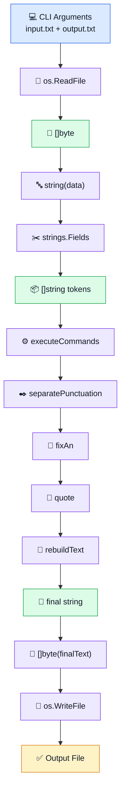
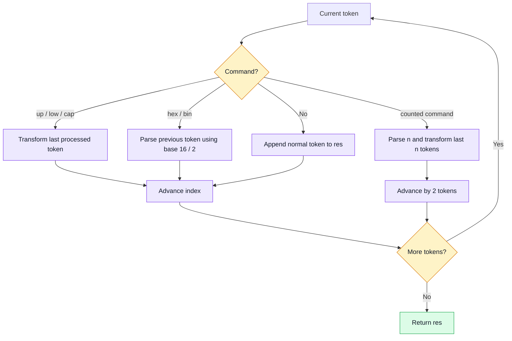

<div align="center">

# 🚀 Go Reloaded

### A deterministic text transformation pipeline written in Go


**Go Reloaded** is a command-line text processing tool that reads a text file, applies a defined set of transformations, rebuilds the text with corrected formatting, and writes the result to an output file.

</div>

---

## 📚 Table of Contents

- [Project Overview](#-project-overview)
- [Core Requirements](#-core-requirements)
- [How to Run](#-how-to-run)
- [High-Level Architecture](#-high-level-architecture)
- [Execution Flow Inside `main`](#-execution-flow-inside-main)
- [Function Reference](#-function-reference)
- [Data Structures & Types](#-data-structures--types)
- [Algorithms](#-algorithms)
- [Complexity Analysis](#-complexity-analysis)
- [Important Design Decisions](#-important-design-decisions)
- [Examples](#-examples)
- [Testing & Acceptance](#-testing--acceptance)
- [Project Structure](#-project-structure)
- [Engineering Notes](#-engineering-notes)
- [Learning Outcomes](#-learning-outcomes)
- [Reference](#-reference)

---

# 🎯 Project Overview

Go Reloaded is a small text-completion, editing, and auto-correction tool.

The program receives exactly two user-supplied arguments:

```text
input-file output-file
```

The process is:

1. Read the entire input file.
2. Convert the file contents into text.
3. Tokenize the text.
4. Execute transformation commands.
5. Normalize punctuation.
6. Fix `a` / `an`.
7. Normalize single quotes.
8. Rebuild the final text.
9. Write the result to the output file.

The implementation is intentionally organized as a **pipeline**: each stage has one clear responsibility and passes its output to the next stage.

---

# ✅ Core Requirements

| Feature | Input Example | Output Example |
|---|---|---|
| Hexadecimal conversion | `1E (hex)` | `30` |
| Binary conversion | `10 (bin)` | `2` |
| Uppercase | `go (up)` | `GO` |
| Lowercase | `SHOUTING (low)` | `shouting` |
| Capitalization | `bridge (cap)` | `Bridge` |
| Multi-word uppercase | `so exciting (up, 2)` | `SO EXCITING` |
| Multi-word lowercase | `ONE TWO (low, 2)` | `one two` |
| Multi-word capitalization | `one two (cap, 2)` | `One Two` |
| Punctuation spacing | `hello ,world !` | `hello, world!` |
| Punctuation groups | `wait ... really !?` | `wait... really!?` |
| Single quotes | `' awesome '` | `'awesome'` |
| Multi-word quotes | `' very good '` | `'very good'` |
| Article correction | `a apple` | `an apple` |
| Article correction before `h` | `a house` | `an house` |

> The `a` → `an` behavior follows the project specification: the change is triggered when the next word starts with a vowel or `h`.

---

# ▶️ How to Run

## Prerequisites

- Go installed
- A Go module initialized in the project directory

Check Go:

```bash
go version
```

Run:

```bash
go run . sample.txt result.txt
```

Inspect the output:

```bash
cat result.txt
```

Argument mapping:

```text
os.Args[0] → executable/program path
os.Args[1] → input file
os.Args[2] → output file
```

Therefore:

```go
len(os.Args) == 3
```

although the user provides only **two project arguments**.

---

# 🧭 High-Level Architecture



The data stays as `[]string` for as long as possible:

```text
raw file
   ↓
[]byte
   ↓
string
   ↓
[]string
   ↓
transformations
   ↓
[]string
   ↓
final string
   ↓
output file
```

---

# 🧠 Execution Flow Inside `main`

`main` is the orchestrator of the application.

Conceptually:

```go
func main() {
    validate arguments
    resolve input and output paths

    read input file
    convert []byte to string
    tokenize text

    execute commands
    separate punctuation
    fix a/an
    normalize quotes
    rebuild final text

    write output file
}
```

Detailed data flow:

```text
os.Args
  │
  ├── inputFile  : string
  └── outputFile : string
          │
          ▼
os.ReadFile(inputFile)
          │
          ▼
data : []byte
          │
          ▼
text := string(data)
          │
          ▼
words := strings.Fields(text)
          │
          ▼
words : []string
          │
          ▼
executeCommands(words)
          │
          ▼
separatePunctuation(words)
          │
          ▼
fixAn(words)
          │
          ▼
quote(words)
          │
          ▼
rebuildText(words)
          │
          ▼
finalText : string
          │
          ▼
[]byte(finalText)
          │
          ▼
os.WriteFile(...)
```

## Why the order matters

A counted command:

```text
(up, 2)
```

is tokenized by `strings.Fields` roughly as:

```go
[]string{"(up,", "2)"}
```

`executeCommands` expects that structure. If punctuation were separated first, the comma could become its own token and break command recognition.

---

# 🧰 Function Reference

## `capitalize`

```go
func capitalize(s string) string
```

Uppercases the first character segment and lowercases the remainder.

```text
"bRIDGE" → "Bridge"
```

- Input: `string`
- Output: `string`

---

## `applyLastN`

```go
func applyLastN(words []string, n int, command string) []string
```

Applies `up`, `low`, or `cap` to the last `n` processed tokens.

- `words []string` — processed tokens
- `n int` — number of tokens to transform
- `command string` — transformation type
- Returns: `[]string`

### Slice behavior

The function changes existing slice elements:

```go
words[i] = ...
```

A slice is passed by value, but its copied header still points to the same backing array, so element mutations are visible through the caller's slice.

---

## `executeCommands`

```go
func executeCommands(words []string) []string
```

Parses and executes:

```text
(up)
(low)
(cap)
(hex)
(bin)
(up, n)
(low, n)
(cap, n)
```

It also consumes command tokens so they do not appear in the output.

The loop index is controlled manually:

```go
for i := 0; i < len(words); {
```

because different operations consume different token counts:

```text
normal token → 1
(up)         → 1
(hex)        → 1
(up, 2)      → 2
```

---

## `isPunc`

```go
func isPunc(r rune) bool
```

Checks whether one rune is one of:

```text
. , ! ? : ;
```

- Input: `rune`
- Output: `bool`

---

## `separatePunctuation`

```go
func separatePunctuation(words []string) []string
```

Splits mixed text/punctuation tokens into ordered runs.

```text
hello,world!
```

becomes:

```go
[]string{"hello", ",", "world", "!"}
```

It uses:

```text
current → normal text buffer
punc    → punctuation buffer
```

When the type changes, the current buffer is flushed to `res`. At the end of each token, a final flush stores any remaining content.

---

## `isPuncToken`

```go
func isPuncToken(token string) bool
```

Checks whether an entire token should be treated as punctuation during final reconstruction.

Useful for:

```text
...
!?
!!
```

- Input: `string`
- Output: `bool`

---

## `quote`

```go
func quote(words []string) []string
```

Normalizes paired single quotes.

```text
' very good '
```

becomes:

```text
'very good'
```

The implementation acts like a small state machine:

```text
outside quote
→ opening quote
→ inside quote
→ closing quote
→ outside quote
```

---

## `fixAn`

```go
func fixAn(words []string) []string
```

Converts:

```text
a → an
A → An
```

when the next word begins with:

```text
a e i o u h
```

It uses one-token look-ahead and protects access with:

```go
i+1 < len(words)
```

---

## `rebuildText`

```go
func rebuildText(words []string) string
```

Rebuilds the processed token slice into final text.

Rules:

- Normal words use normal spacing.
- Punctuation attaches directly to previous text.
- No unwanted space is inserted before punctuation.

```go
[]string{"Hello", ",", "world", "!"}
```

becomes:

```text
Hello, world!
```

---

## `main`

```go
func main()
```

Coordinates:

```text
validate
→ read
→ tokenize
→ transform
→ rebuild
→ write
```

---

# 🧱 Data Structures & Types

| Type | Role | Example |
|---|---|---|
| `[]string` | Token stream | `{"Go", "is", "fun"}` |
| `string` | Text, token, path, final output | `"sample.txt"` |
| `[]byte` | Raw file data | output of `os.ReadFile` |
| `rune` | Unicode code point | `'!'` |
| `byte` | Alias for `uint8` | direct string indexing |
| `int` | Indexes and counts | `i`, `n` |
| `int64` | Result of `strconv.ParseInt` | parsed number |
| `bool` | Conditions/state | punctuation checks |
| `error` | I/O and conversion errors | `err` |

## `byte` vs `rune`

```go
word[0]
```

returns a `byte`.

```go
for _, r := range word
```

provides a `rune`.

- `byte` = alias for `uint8`
- `rune` = alias for `int32`, representing a Unicode code point

---

# 🧮 Algorithms

## 1. Manual command parser



---

## 2. Numeric base conversion

Hex:

```go
strconv.ParseInt(value, 16, 64)
```

Binary:

```go
strconv.ParseInt(value, 2, 64)
```

Key idea:

```text
base ≠ type
```

The base determines how the textual number is interpreted.

```text
"101" base 2  → 5
"101" base 10 → 101
```

The integer is formatted back to decimal text with:

```go
strconv.FormatInt(value, 10)
```

---

## 3. Backward transformation window

For:

```text
(up, 3)
```

the algorithm calculates:

```text
start = len(words) - 3
```

and transforms:

```text
start ... len(words)-1
```

If `n` is larger than the number of available processed tokens:

```text
start = 0
```

which avoids a negative index and applies the operation to all available tokens.

---

## 4. Punctuation segmentation

Each token is scanned rune by rune.

```text
current → text run
punc    → punctuation run
```

Example:

```text
Go!!!is,great
```

becomes:

```go
[]string{"Go", "!!!", "is", ",", "great"}
```

The core pattern is:

```text
Buffer
→ detect boundary
→ flush
→ continue
→ final flush
```

---

## 5. Quote state machine

The same `'` symbol can mean opening or closing quote depending on state:

```text
outside
  ↓ '
inside
  ↓ '
outside
```

---

## 6. One-token look-ahead

For:

```text
a apple
```

the algorithm examines:

```text
current token = "a"
next token    = "apple"
```

Then checks whether the next token starts with:

```text
a e i o u h
```

---

# ⏱️ Complexity Analysis

Let:

```text
C = total input characters
T = number of tokens
L = one token length
K = number of tokens affected by a counted command
```

| Function | Time Complexity | Extra Space | Notes |
|---|---:|---:|---|
| `capitalize` | `O(L)` | `O(L)` | Creates transformed strings |
| `applyLastN` | `O(chars in last K tokens)` | transformation-dependent | Revisits prior tokens |
| `executeCommands` | Usually near `O(C)`; worst-case can approach `O(C × T)` | `O(C)` | Repeated counted commands can revisit processed text |
| `isPunc` | `O(1)` | `O(1)` | Fixed punctuation set |
| `separatePunctuation` | Logical scan `O(C)` | `O(C)` | Repeated `string +=` may cause higher copying cost |
| `isPuncToken` | `O(L)` | `O(1)` | Scans one token |
| `quote` | `O(C)` | `O(T)` | One token pass |
| `fixAn` | `O(T)` under project assumptions | `O(1)` | One-token look-ahead |
| `rebuildText` | Logical scan `O(C)` | `O(C)` | Repeated concatenation can approach `O(C²)` copying |
| `main` | Dominated by pipeline | `O(C)`+ | Entire file is loaded into memory |

For normal project-sized text files, the program behaves close to a linear processing pipeline.

Potential large-input optimizations include:

```go
strings.Builder
```

and streaming input.

---

# 🧩 Important Design Decisions

## Why `res` exists

`words` is the original token stream.

`res` is the **processed output so far**.

Example:

```text
hello (cap) (up)
```

After `(cap)`:

```go
res == []string{"Hello"}
```

The next `(up)` must operate on:

```go
res[len(res)-1]
```

because `words[i-1]` may itself be a command token.

---

## Why bounds checks matter

Before:

```go
words[i+1]
```

the code verifies:

```go
i+1 < len(words)
```

Without the check, invalid access could produce:

```text
panic: runtime error: index out of range
```

---

## Why slice element mutations are visible

A slice descriptor contains roughly:

```text
pointer to backing array
length
capacity
```

Passing a slice copies the descriptor, but both descriptors can still point to the same backing array.

Therefore:

```go
words[i] = ...
```

inside `applyLastN` is visible to the caller.

---

## Why `os.ReadFile` works here

`os.ReadFile` loads the whole file into memory as `[]byte`.

That is simple and appropriate for the small text files expected in this project.

For very large files, streaming with `bufio.Reader` or `bufio.Scanner` may be more suitable.

---

# 🧪 Examples

## Commands

```text
Input:
This is so exciting (up, 2)

Output:
This is SO EXCITING
```

## Number conversion

```text
Input:
Simply add 42 (hex) and 10 (bin).

Output:
Simply add 66 and 2.
```

## Punctuation

```text
Input:
I was sitting over there ,and then BAMM !!

Output:
I was sitting over there, and then BAMM!!
```

## Quotes

```text
Input:
I am exactly how they describe me : ' awesome '

Output:
I am exactly how they describe me: 'awesome'
```

## Article correction

```text
Input:
There it was . A amazing rock !

Output:
There it was. An amazing rock!
```

---

# 🧪 Testing & Acceptance

The implementation was manually validated against:

- Hexadecimal and binary conversion
- Single-word transformations
- Counted transformations
- Punctuation placement
- Punctuation groups
- Single-word quotes
- Multi-word quotes
- `a` / `A` → `an` / `An`
- Empty input
- Whitespace-only input
- Missing input file
- Output-file creation
- Output-file overwrite
- Boundary checks

Typical acceptance run:

```bash
go run . sample.txt result.txt
cat result.txt
```

Example:

```text
Input:
Ready , set , go (up) !

Output:
Ready, set, GO!
```

---

# 📁 Project Structure

```text
go-reloaded/
├── go.mod
├── main.go
├── README.md
├── sample.txt
└── result.txt
```

- `main.go` — complete program and processing pipeline
- `go.mod` — Go module definition
- `sample.txt` — input file used for execution/testing
- `result.txt` — generated output file
- `README.md` — project documentation

---

# 🛠️ Engineering Notes

## Whitespace normalization

The project uses:

```go
strings.Fields(text)
```

This normalizes whitespace into tokens, so original runs of spaces, tabs, and line breaks are not preserved exactly.

That behavior is suitable for the normalization goal of the project.

## Current error-handling style

The CLI exits early when:

- argument count is invalid
- the input file cannot be read
- the output file cannot be written

The current implementation favors simple control flow over verbose CLI error reporting.

## Potential future improvements

- `strings.Builder` for more efficient final string construction
- Automated unit/integration tests
- More explicit parser abstractions
- Structured CLI error messages
- Streaming processing for very large files

These are engineering extensions, not required for the current functional implementation.

---

# 🎓 Learning Outcomes

### Go fundamentals

- strings
- slices
- indexing
- `range`
- `append`
- `byte`
- `rune`
- functions
- errors

### Standard library

```text
os
strings
strconv
```

### Algorithms

- Token processing
- State machines
- Look-ahead
- Boundary checking
- Buffer/flush parsing
- Base conversion
- Manual parser control flow

### Software design

- Processing pipeline
- Separation of responsibilities
- Deterministic transformations
- Defensive indexing
- Input → Process → Output architecture

---

# 🔗 Reference

Official 01Edu Go Reloaded subject:

https://public.01-edu.org/subjects/go-reloaded/

---

<div align="center">

### 🟦 Input → 🟪 Transform → 🟩 Rebuild → 🟨 Output

Built with Go as an exercise in text processing, parsing, data transformation, and clean execution flow.

</div>
